# Inkwell - EPUB reader + audiobook streaming in Flutter

A cross-platform reading and listening app for a publisher: an EPUB ebook reader with real pagination, audiobook streaming with lock-screen controls, a daily editorial feed, a searchable reference library, accounts with bookmarks and favourites, and free / premium membership. One Flutter codebase for iOS and Android.

## Demo

| iOS | Android |
|---|---|
|  |  |

Same codebase running on both platforms: sign in, open today's reading, page through the EPUB, change theme and font, switch to audio at the same chapter, change speed, browse chapters, then upgrade on the paywall.

## Screenshots

| Welcome | Sign in | Today | Daily essay |
|---|---|---|---|
|  | 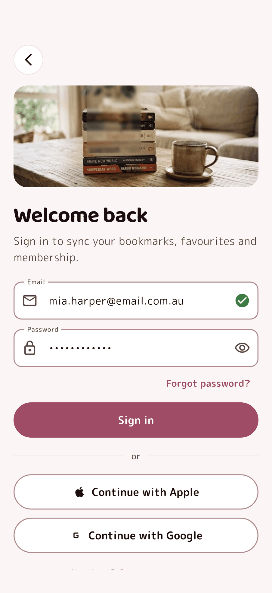 | 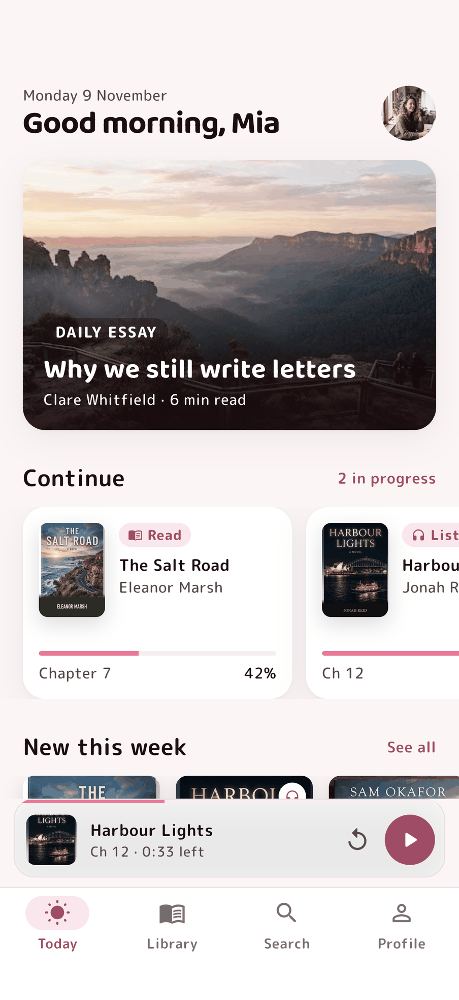 | 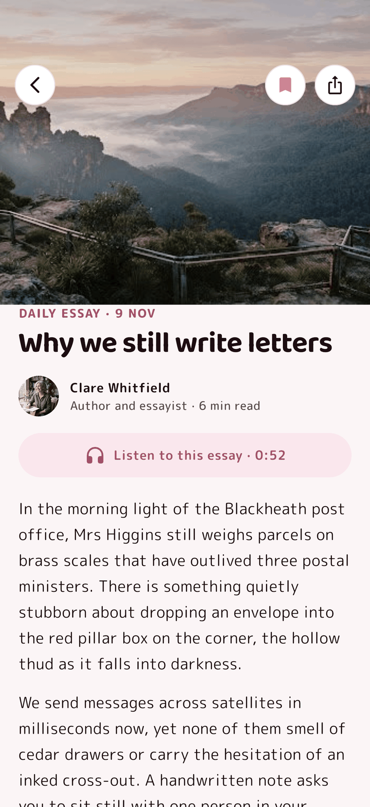 |

| Library | Book detail | EPUB reader | Display settings |
|---|---|---|---|
| 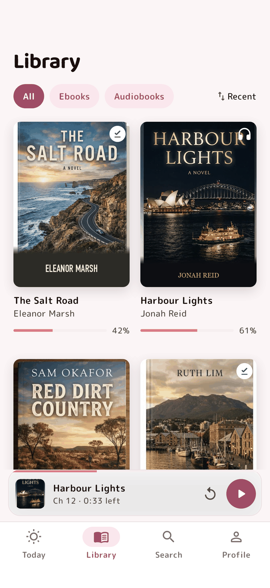 | 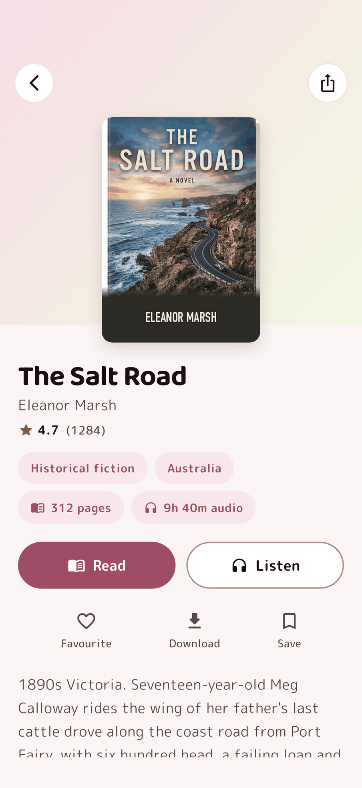 | 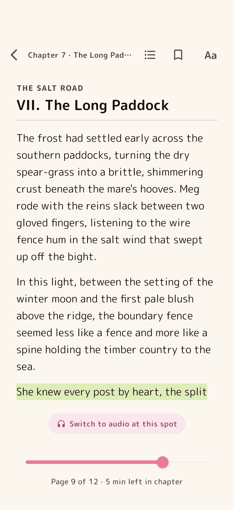 | 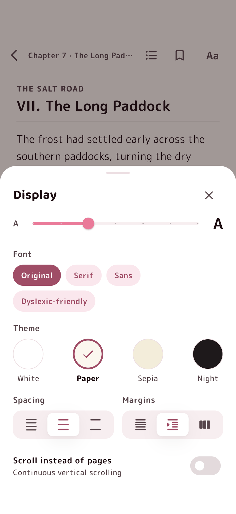 |

| Bookmarks | Audiobook player | Chapters + sleep timer | Search |
|---|---|---|---|
| 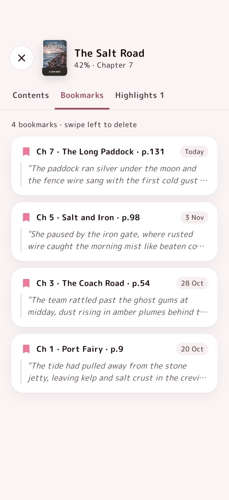 | 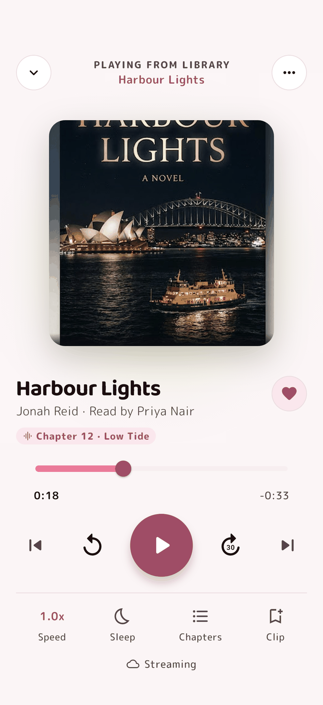 | 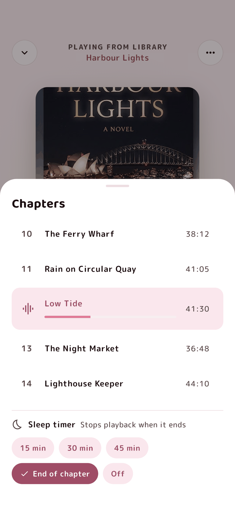 | 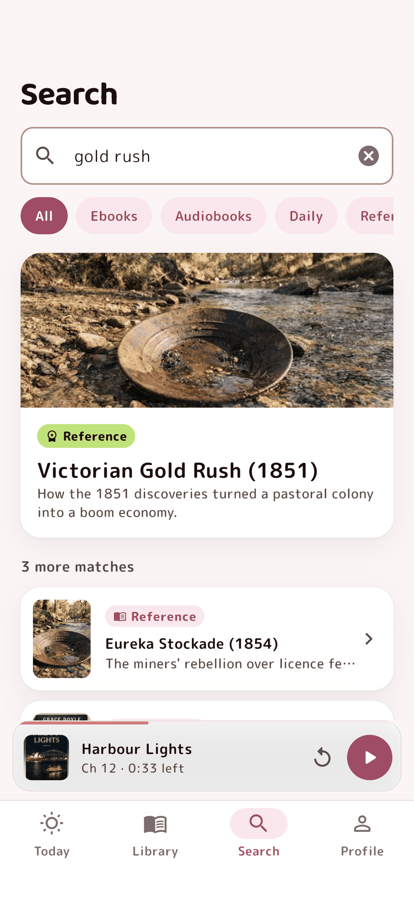 |

| Reference entry | Favourites | Premium | Profile |
|---|---|---|---|
| 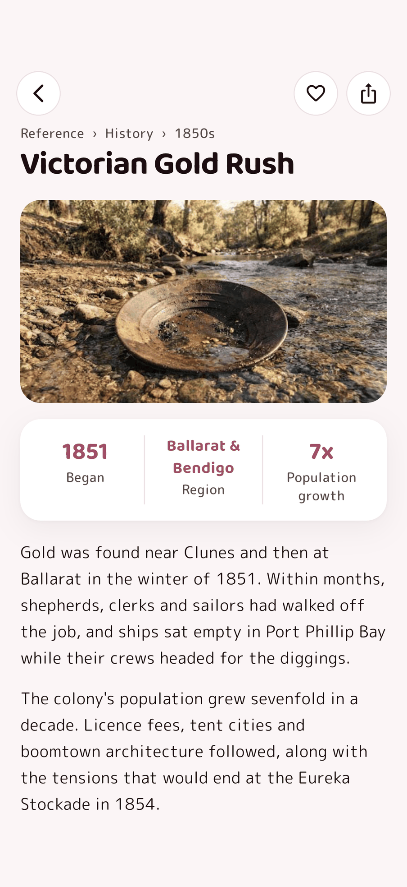 | 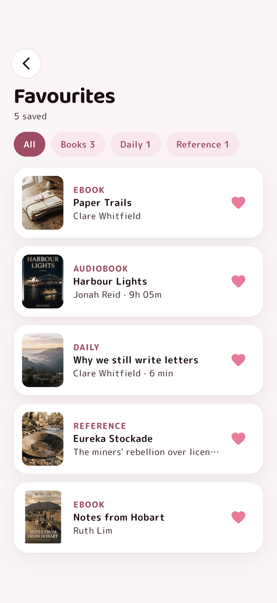 | 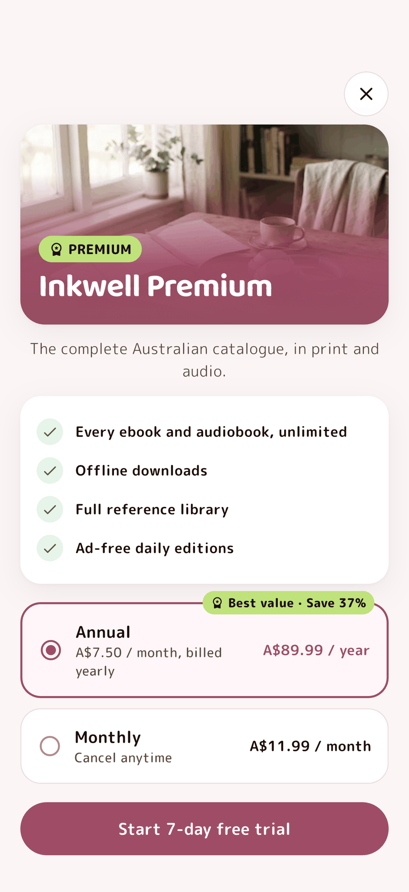 | 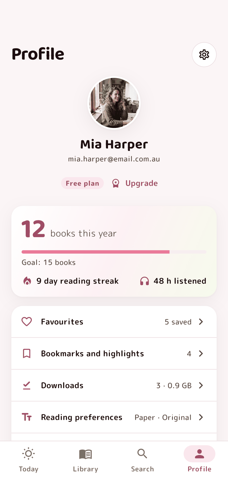 |

| Downloads | Today, first run | Library, first run |
|---|---|---|
| 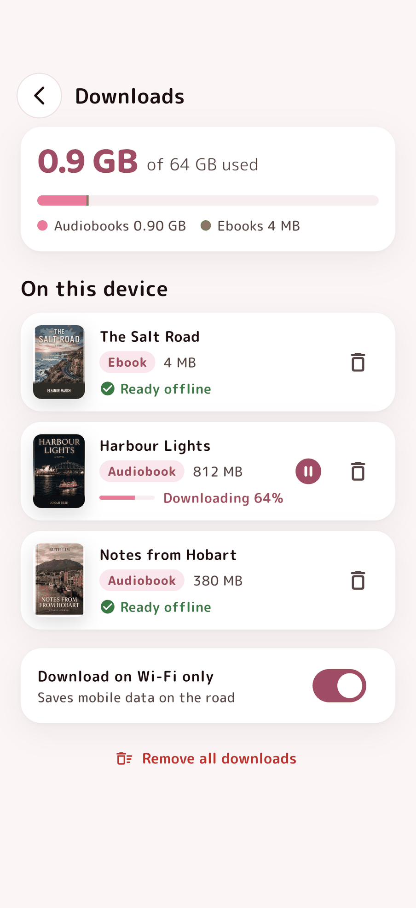 | 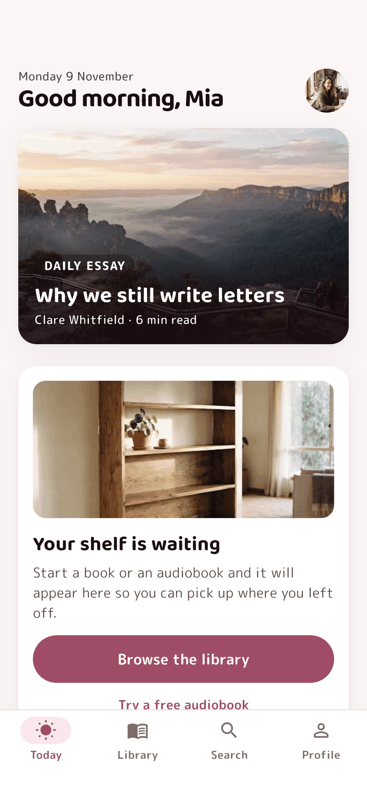 | 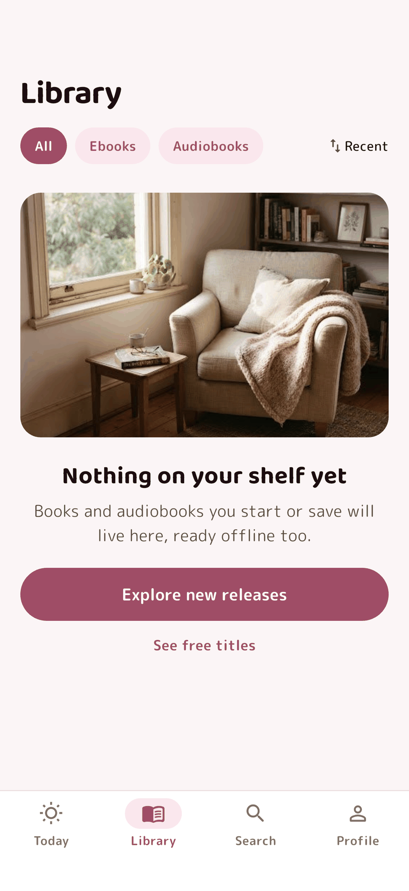 |

## What it shows

- **EPUB reading.** Real `.epub` packages are parsed on device (`container.xml` -> OPF -> spine -> XHTML) and paginated with `TextPainter`, so the page count follows font size, line spacing and margins. Table of contents, bookmarks with swipe-to-delete, highlights, a page scrubber, four reading themes (White, Paper, Sepia, Night), four font choices including a dyslexia-friendly spacing, and a continuous-scroll mode.
- **Audiobook streaming.** `just_audio` with `just_audio_background`: lock screen and Control Center / notification controls, background playback, interruption handling, skip back 15 s / forward 30 s, chapter list, playback speed and a sleep timer (15 / 30 / 45 min or end of chapter). A persistent mini player sits above the tab bar.
- **Read to listen hand-off.** "Switch to audio at this spot" opens the narration for the chapter you are reading.
- **Daily editorial.** A Today feed driven by the content payload, with a listenable essay and a link to the author's book.
- **Search + reference library.** One ranked search across ebooks, audiobooks, daily essays and reference entries, with type filters. Reference entries have quick facts, related titles and see-also links.
- **Accounts, favourites, bookmarks.** Sign in for a returning reader or create a free account (first-run empty states). Favourites across books, essays and reference.
- **Free and premium.** Premium titles show a badge and route to the paywall (annual / monthly plans, 7-day trial, restore purchases).
- **Offline downloads.** Storage summary, per-title progress, pause / resume, Wi-Fi only.
- **CMS-driven content.** Titles, chapters, daily pieces and reference entries come from one JSON payload shaped like a headless CMS response, so editors publish without an app release.

## Flow

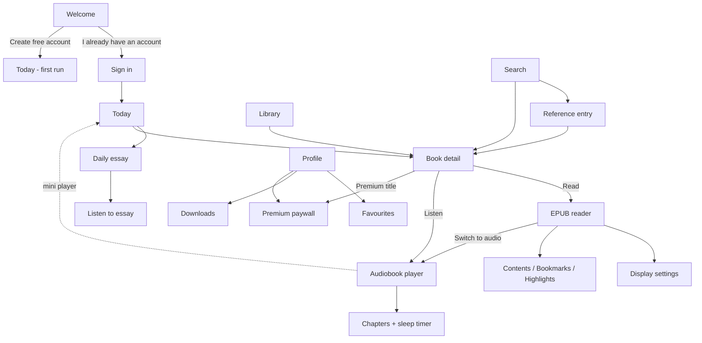

## Architecture

```
lib/
  data/
    models.dart            Book, Chapter, DailyPiece, ReferenceEntry, Catalog, Bookmark
    cms_repository.dart    loads the content payload, ranked cross-type search
    epub/epub_book.dart    EPUB parser (archive + xml)
    epub/paginator.dart    TextPainter-based pagination
  state/
    providers.dart         Riverpod: session, membership, progress, favourites, bookmarks,
                           reader settings, downloads
    audio_controller.dart  just_audio + just_audio_background player, speed, sleep timer
  screens/                 one file per screen
  widgets/                 shared components, tab shell + mini player
  theme/                   design tokens (colour, type, radius, elevation)
tool/build_content.py      builds the bundled EPUBs and narration samples
```

- Flutter 3, Dart 3, Riverpod 3 (`Notifier`), go_router (`StatefulShellRoute` for tabs).
- Production swaps: the bundled JSON for a headless CMS (Sanity, Strapi or Payload) behind a CDN cache; bundled audio for signed, expiring HLS / MP3 URLs; the local entitlement for RevenueCat over App Store and Google Play billing; local state for Supabase or Firebase sync.
- Unit tests in `test/` cover EPUB parsing and pagination (no text lost, bigger font gives more pages). `integration_test/` drives the app for the screenshots and demo above.

## Run

```sh
flutter pub get
flutter run
```

Demo content: the EPUBs and narration samples are original text written for this demo. One chapter per audiobook is narrated; other chapters reuse that sample.
